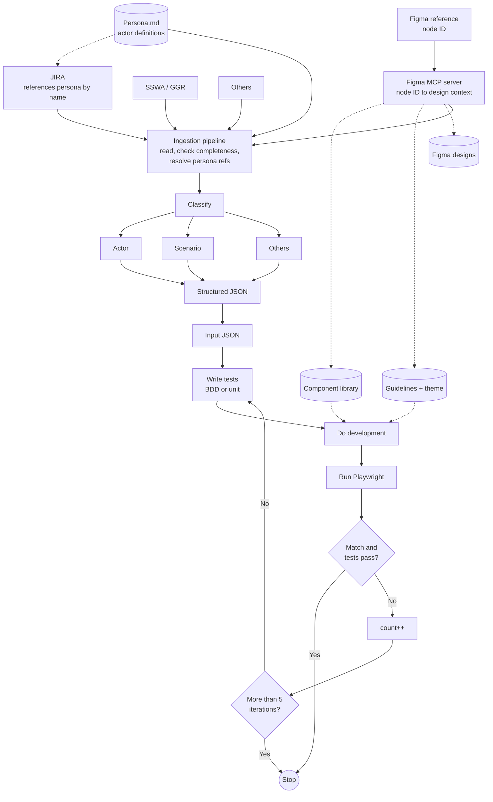

# Agentic Delivery Pipeline: Chat Context and Handoff

Handoff from a Claude chat session (Oct 18, 2026) to continue in Claude Code. It records what was sketched, what was decided, what was produced, what was critiqued, and what to build next.

**How to read this file.** Statements are tagged where it matters:
- **[Confirmed]**: you said it or drew it.
- **[Inferred]**: my reading of a sketch or a suggestion I made. Treat as unverified until you agree.

---

## 1. Goal

Build an **agentic delivery pipeline** that turns JIRA tickets plus Figma designs into tested UI code, using AI agents. A structured **Input JSON** is produced from the sources, then a **test-driven loop** writes tests, develops against them, validates with Playwright, and retries up to 5 times.

The chat also used the design as material for **Claude certification (CCA-style) exam prep**: the architecture was critiqued against exam domains (agents and workflows, tools and MCP, security and safety, evaluation, output format).

---

## 2. Source material: your hand-drawn sketches

Three photos were shared. Handwriting was partly hard to read; uncertain items are listed at the end of this section.

### Sketch A: the build loop (photo 1, and photo 2 which is the same page upside-down)

Flow as drawn:

1. **Start** → **Input JSON**
2. **Write tests** (BDD or unit)
3. **Do development** against the tests
4. **Run Playwright to validate**
5. Decision **"Is match & tests pass?"**
   - **Yes** → **Stop**
   - **No** → **count++** → decision **"Check count > 5 iterations"**
     - **Yes** → **Stop**
     - **No** → loop back to **Write tests**

Note: the `count++` box was only legible in the upside-down photo. In the first photo it was unclear. [Confirmed from the second photo]

Also visible: a scribbled-out annotation next to "Input JSON" (could not be read).

### Sketch B: ingestion and evaluation (photo 3)

Top section:
- Source bubbles: **JIRA**, **Figma**, **SSWA / GGR** (partly illegible), **Others**.
- All feed an **Ingestion Pipeline**.
- Pipeline note: *"Reads the input & determines if all inputs are available. No missing inputs."*
- Pipeline output goes into a bracketed set of categories: **Actor (types of credentials)**, **Scenario**, **Others**.
- Result: **"A JSON is returned → Output"**.

Bottom row: **JSON Input → Eval Loop → (unlabeled oval) → End**.

### Uncertain readings from the sketches
- "SSWA / GGR" is my best reading of the third source bubble. Please confirm what it is.
- The unlabeled oval between "Eval Loop" and "End" has no label.
- It is not yet clear whether the bottom "JSON Input → Eval Loop → End" row is the same as Sketch A's loop or a separate evaluation stage. [Inferred: treated as the same loop]

---

## 3. Clarifications you gave during the chat [Confirmed]

1. **Actors come from a persona file.** Actors are provided as a `Persona.md` (or another .md file). A JIRA ticket references a persona by name as the actor. The ingestion step must resolve that reference to the persona definition. Actors are not extracted from the JIRA text itself.
2. **Design system exists.** A **component library**, **design guidelines**, and a **theme library** exist, with corresponding designs in **Figma**.
3. **Figma MCP server exists.** It understands a Figma **node ID** and pulls the design context needed from Figma.

---

## 4. Pipeline as modeled (combined from both sketches and the clarifications)

### Stage 1: Inputs
| Source | Role |
|---|---|
| JIRA ticket | Requirement; references a persona by name; carries a Figma node ID |
| Persona.md (or other .md) | Actor definitions, including credential types |
| Figma reference | Node ID only, not the design itself |
| SSWA / GGR | Another input source (identity unclear) |
| Others | Unspecified extra sources |

### Stage 2: Design context
- **Figma MCP server** resolves node ID → design context.
- It cross-references the **component library**, the **design guidelines + theme library**, and the **Figma designs** mapped to library components.
- Output feeds both ingestion and (via the library and theme) the development step.

### Stage 3: Ingestion pipeline
- Reads every input.
- Checks completeness ("no missing inputs").
- Resolves persona references against Persona.md.

### Stage 4: Classification → Input JSON
- Buckets: **Actor** (resolved from persona), **Scenario**, **Others**.
- Emits one structured **JSON**.

### Stage 5: Build loop (max 5 iterations)
`Input JSON → Write tests → Do development → Run Playwright → Match and tests pass?` with retry through `count++` and the iteration cap, as in Sketch A.

### Main flow as Mermaid (clean version, no annotations)



---

## 5. Where AI is doing the work

Which steps need a model and which are plain code. Everything here is **[Inferred]** from the diagrams; it was not confirmed as your design.

**Likely AI:**
1. **Ingestion**: judging whether inputs are complete when they are unstructured (JIRA text, design annotations), and resolving a persona reference to the right Persona.md entry (loose, semantic matching).
2. **Classification** into Actor / Scenario / Others and extraction into JSON.
3. **Write tests**: generating BDD or unit tests from the JSON.
4. **Do development**: generating the implementation against the tests, using the component library and theme.
5. **Match decision**: if "match" means a semantic comparison of output against the design or spec, rather than only Playwright pass/fail.
6. **Figma node resolution**: turning a node ID into the right component, variant and theme tokens. The MCP server does the lookup; mapping to library naming may need a model.

**Plain code (no AI needed):**
- Running Playwright, `count++`, the `count > 5` check, Start/Stop, and routing.

---

## 6. Subagents, skills and MCP: mapping

| Stage | MCP | Subagent | Skill |
|---|---|---|---|
| Ingestion | **Built:** Figma MCP. **Not built:** JIRA / persona.md connector [Confirmed that Figma MCP exists; JIRA MCP is my addition] | Optional: one reader per source, in parallel | **Gap:** persona-resolution skill |
| Classification | none | Candidate: one sub-task per bucket | none |
| Write tests | none | Candidate: scoped agent, separate from dev | **Gap:** test-writing skill (BDD/unit conventions) |
| Do development | none | Candidate: own context, separate from tests | **Gap:** design-system skill (component library and theme usage) |
| Validate | Possible: Playwright MCP (decision open) | Candidate: **independent evaluator** | none |

Everything marked Candidate, Gap or Possible is **my suggestion**, not something you described as built.

---

## 7. Critique against CCA-style domains

Seven findings. The severity labels (High / Medium / Low) are **my own judgement**, not from any exam material.

### 1. Security and Safety (High): indirect prompt injection
JIRA text, Figma metadata and Persona.md all flow into a model-driven ingestion step and then into development. Third parties can edit these. Nothing in the design separates data from instructions.
**Fix:** tag all ingested text as untrusted data. It may fill structured fields but must never alter the task definition.

### 2. Tools and MCP (Medium): unversioned node IDs
A Figma node ID stays the same when the design changes, so an old ticket silently resolves to outdated design context.
**Fix:** resolve to a version or last-modified stamp, and warn when it differs from what the ticket was written against.

### 3. Evaluation (High): evaluator and implementer bias
"Is match and tests pass?" mixes Playwright's deterministic result with a semantic judgement. If the model that wrote the code also judges the match, it grades itself.
**Fix:** use an independent evaluator (separate agent or prompt) and a golden or reference set.

### 4. Agents and Workflows (Medium): retry loop carries no diagnostics
The loop counts attempts but does not pass the previous failure (assertion diffs, screenshots, errors) into the next attempt, so it can repeat the same mistake five times.
**Fix:** feed failure details into the next iteration explicitly.

### 5. Output format (Medium): no schema or version on the JSON
Every downstream step guesses the shape of the JSON.
**Fix:** pin a versioned JSON Schema and validate before the dev loop starts.

### 6. Source conflicts (Low): no precedence rule
No rule for what wins when JIRA, Persona.md and Figma disagree.
**Fix:** define a source-of-truth order and flag conflicts instead of resolving them silently.

### 7. Human oversight (Medium): no review gate, and the cap exit looks like success
Nothing reviews the result before Stop. Hitting the 5-iteration cap exits through the same Stop as a pass.
**Fix:** add an approval step, and treat the cap-exceeded exit as a failure that needs review.

---

## 8. Files produced in the chat

| File | What it is |
|---|---|
| `pipeline-flow.mermaid` | Combined flow with critique, MCP, subagent and skill annotation layers (cluttered; superseded by the draw.io pages) |
| `pipeline-critique.md` | Standalone critique write-up, organized by exam domain |
| `pipeline-flow.drawio` (3 pages) | Page 1 **Flow** (clean, with red numbered badges 1 to 7), page 2 **AI layers** (stage vs MCP / subagent / skill grid), page 3 **Critique** (one card per finding, numbered to match the badges) |
| `pipeline-flow-preview.png` | Rendered preview of the Flow page |

### Relation to the repo folder
Your connected folder `the-agentic-delivery-pipeline` already contains `pipeline-flow.drawio`, `pipeline-flow-spacious.drawio`, `pipeline-flow.drawio.svg`, `Agentic Delivery.pdf`, `mcp.jpeg` and a `CLAUDE.md`. The 3-page file from this chat appears to be the same size as `pipeline-flow-spacious.drawio`. [Inferred from the byte size: not diffed.] The repo's `CLAUDE.md` says to keep the annotations consistent across both `.drawio` variants and to keep the `.svg` export in sync with `pipeline-flow.drawio`.

### How the draw.io file was made
Generated by a Python script that writes mxGraph XML (containers, orthogonal edges, explicit waypoints), then rendered to PNG in headless Chromium to check spacing and edge routing. The first version was rejected as messy (annotation boxes with crossing dashed lines); the rebuild moved annotations onto separate pages. There was no draw.io connector available in the session, so the file is imported manually (File → Open in app.diagrams.net).

---

## 9. Proposed working version [Inferred: a suggestion, not agreed]

Build with the **Claude Agent SDK in TypeScript** (matches your stack), with the loop as ordinary code:

- **Orchestrator** script owns the `count < 5` loop, retries and Start/Stop. The cap lives in code, not in a prompt.
- **Subagents:** ingestion, test-writer, developer, independent evaluator.
- **MCP servers:** Figma, a JIRA/Atlassian connector, Playwright (all existing servers, configured rather than built).
- **Skills** (as skill files): persona resolution, test-writing conventions, design-system usage.
- **Between steps:** validate the JSON against a schema; pass Playwright failure output into the next iteration.

I did not verify current Agent SDK API details in this chat. Check the docs before relying on specifics.

### Suggested thin first slice
One real JIRA ticket with a Figma node ID → produce the Input JSON → run one write-tests / develop / Playwright cycle with the 5-iteration cap. Add the rest after that works.

### Draft Input JSON shape [Inferred: proposal only]
```json
{
  "schemaVersion": "0.1.0",
  "ticket": { "key": "ABC-123", "summary": "", "acceptanceCriteria": [] },
  "actor": { "persona": "NamedPersona", "resolvedFrom": "Persona.md", "credentialType": "" },
  "scenario": { "description": "", "steps": [] },
  "design": {
    "figmaNodeId": "",
    "figmaVersion": "",
    "components": [],
    "themeTokens": []
  },
  "others": {},
  "missingInputs": [],
  "conflicts": []
}
```
`figmaVersion` addresses finding 2, `missingInputs` is the ingestion completeness check, and `conflicts` addresses finding 6.

---

## 10. Open questions to settle next

1. What exactly is **SSWA / GGR**, and what does it contribute to the JSON?
2. Which **JIRA connector** do you have access to (Atlassian MCP, REST API, export)?
3. What is the **unlabeled oval** after "Eval Loop" in Sketch B, and is Eval Loop the same as the build loop?
4. What does **"match"** mean in "Is match and tests pass?": design fidelity against Figma, or only the test result?
5. What are the **credential types** the Actor represents, and how are they stored in Persona.md?
6. Should the **Playwright** run go through an MCP server or a plain script?
7. What should happen when the **iteration cap** is hit: stop, escalate to a human, or open a draft PR?
8. Where should **human review** sit (before merge, before tests, both)?

---

## 11. Suggested first prompt for Claude Code

> Read `CHAT-CONTEXT.md` and `CLAUDE.md`. Do not change the existing `.drawio` files yet. Start with section 9, "Suggested thin first slice": scaffold a TypeScript project using the Claude Agent SDK with an orchestrator script that owns the 5-iteration loop, plus stub subagents (ingestion, test-writer, developer, evaluator), stub skill files for the three gaps, and an `.mcp.json` for Figma and Playwright. Ask me which JIRA connector to use before wiring ingestion. Validate the Input JSON against a JSON Schema before the loop starts.

---

## 12. Caveats

- Handwriting transcription is my reading and may contain errors (section 2).
- Severity ratings, subagent splits, skill gaps and the Playwright MCP idea are my suggestions.
- The "likely AI" map in section 5 is inferred from diagrams, not from your implementation.
- The draw.io rendering was checked with a library renderer in a headless browser, not in draw.io itself.
